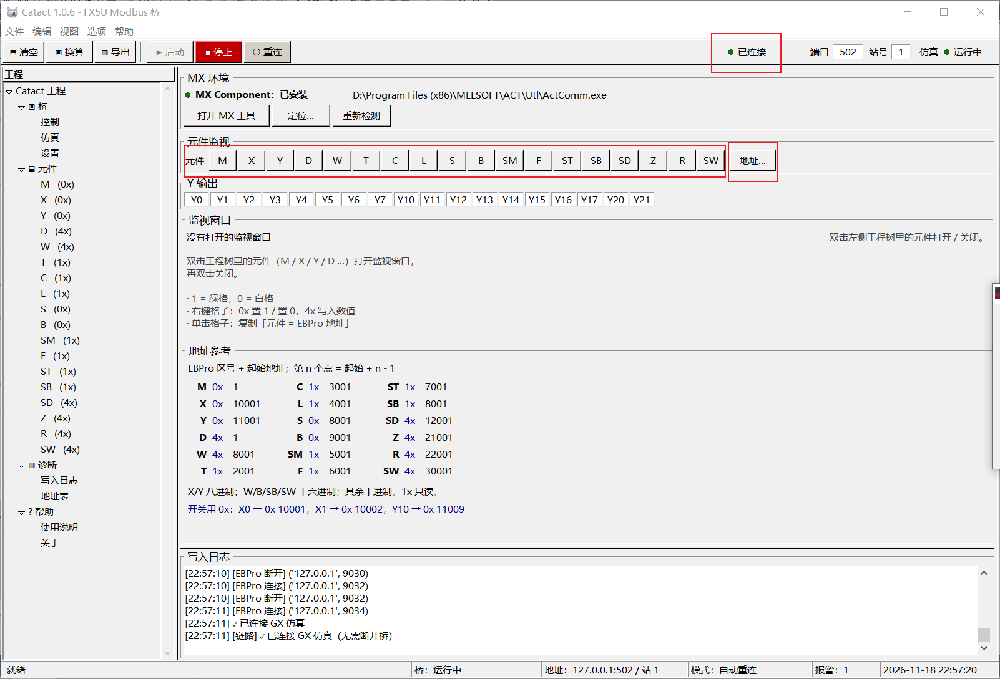
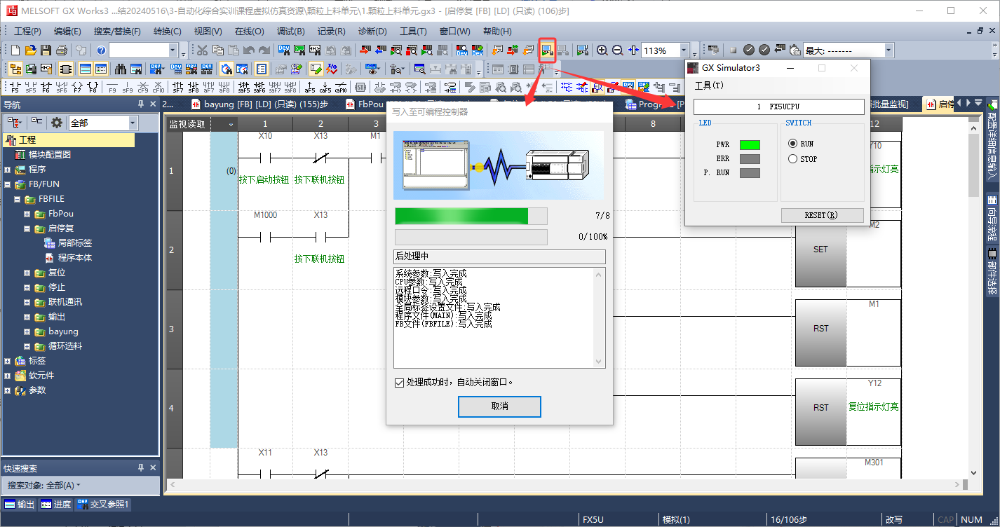
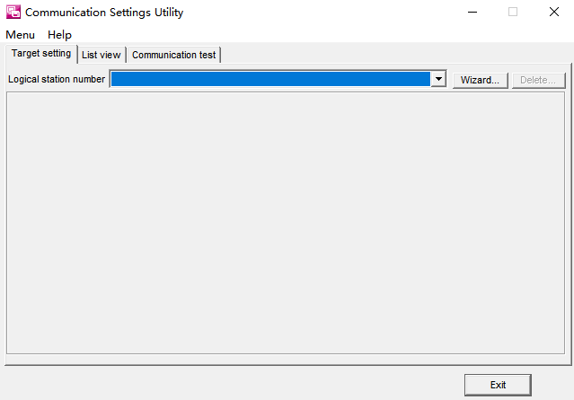
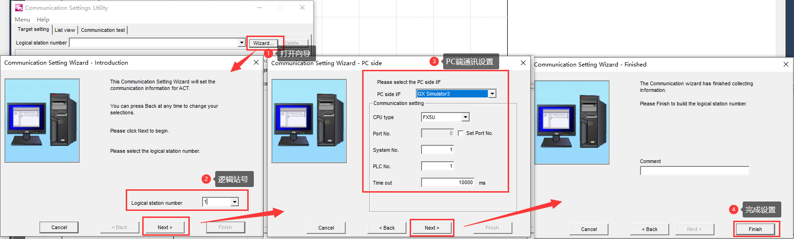
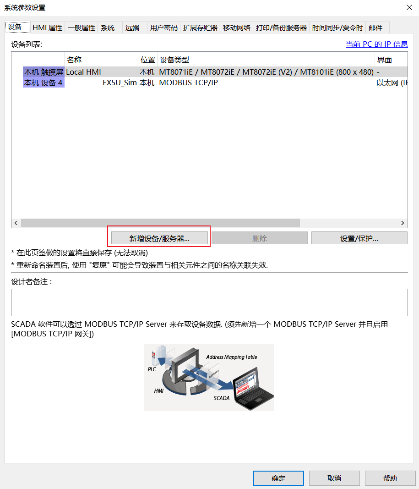
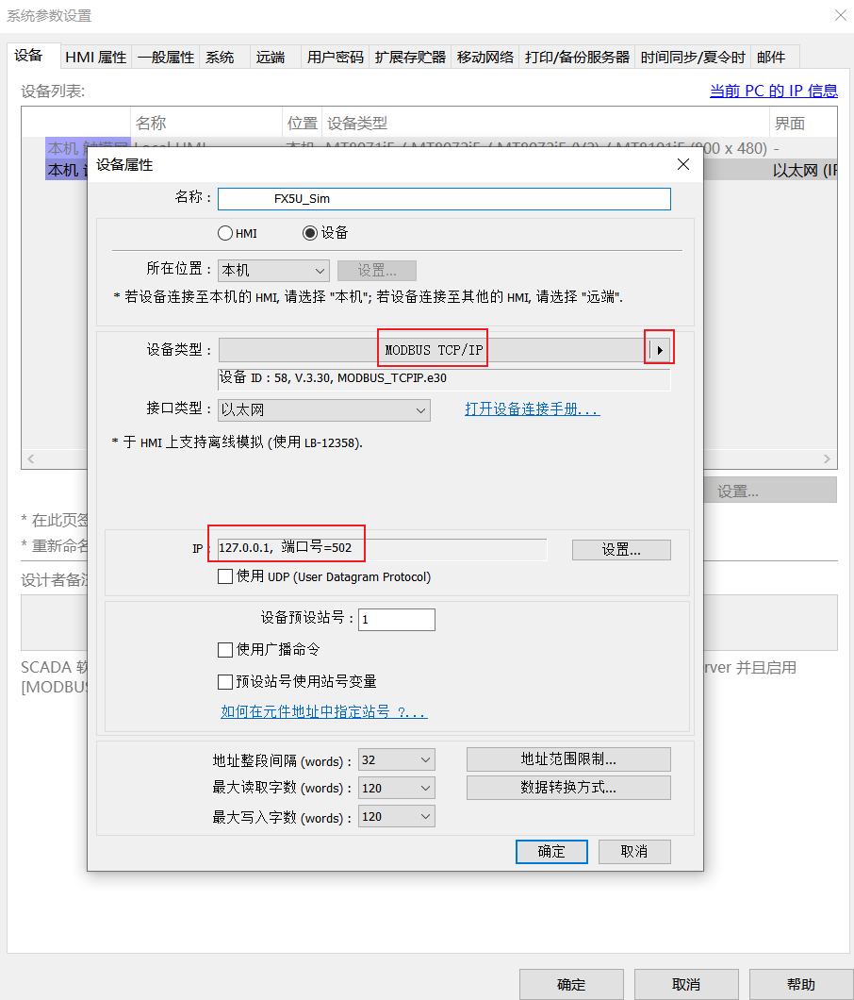
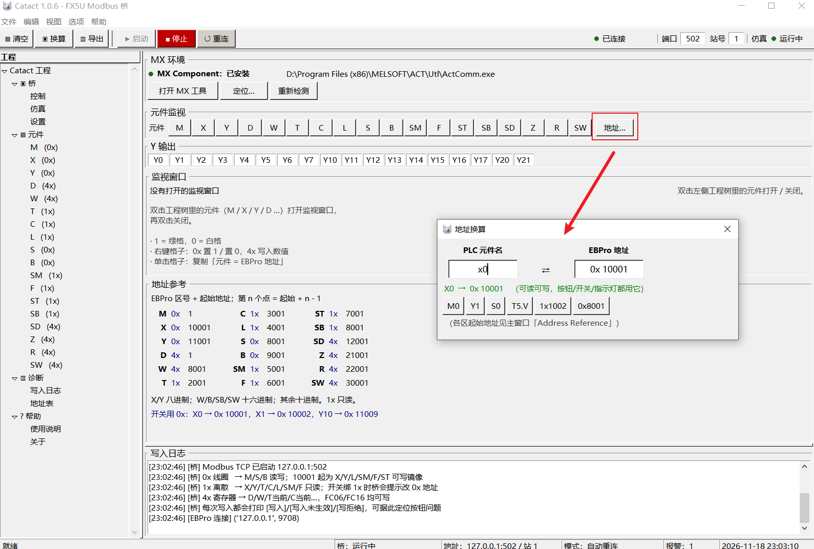
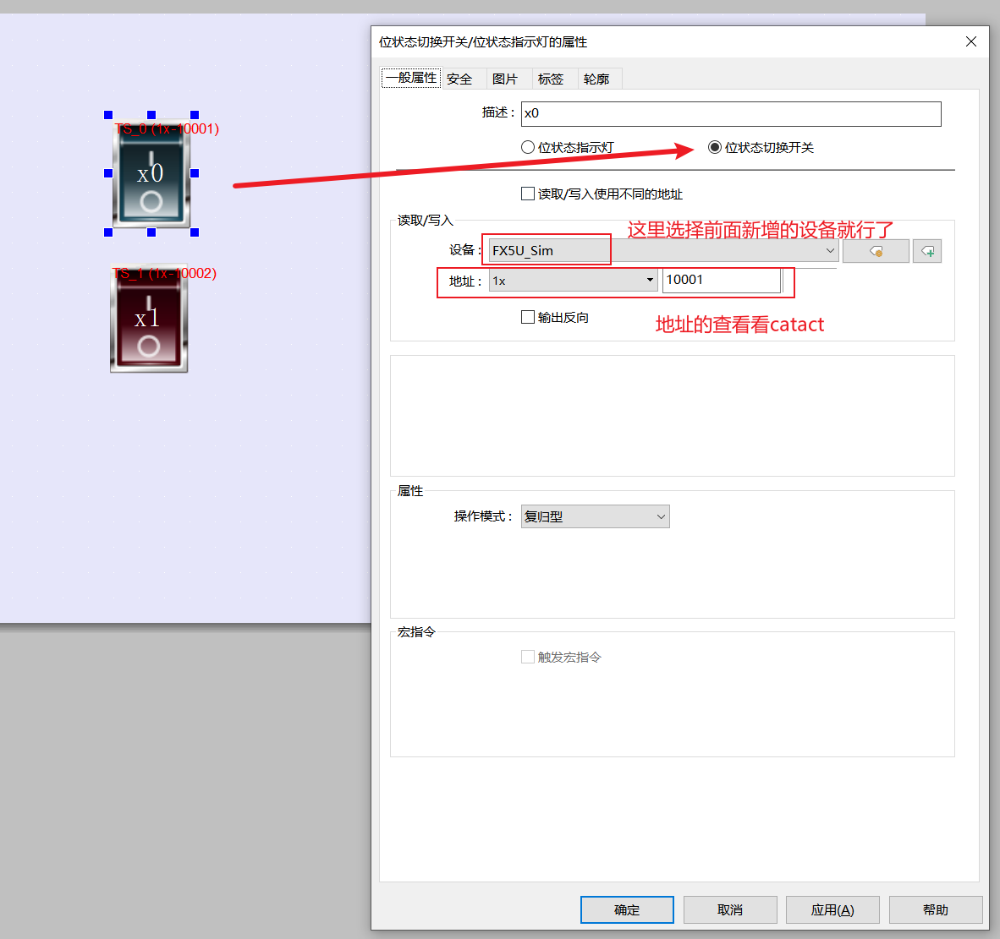

# Catact

把 **GX Works3 的 FX5U 仿真器** 变成 **威纶通 EBPro 能直接连接的 Modbus TCP 设备**。

没有 FX5U 实机，也能在 EBPro 里点按钮、看指示灯、改 D 寄存器；改动实时反映到 GX Simulator3 的软元件里。

> 当前版本：**v1.0.6**（2026-11-18）  
> 下载：[Releases](https://github.com/WaneDay/Catact/releases/latest)  
> 默认中文界面，可在 `选项 → 语言` 切回 English。  
> 本仓库只保留源码、测试、构建脚本和教程，不包含历史测试版本。



## 它解决什么问题

```
EBPro（Modbus TCP 主站）
        │  127.0.0.1:502，站号 1
        ▼
Catact 桥（32 位 Python + MX Component）
        │  ActUtlType（COM，只能 32 位）
        ▼
GX Simulator3（GX Works3 的 FX5U 软 PLC）
```

MX Component 的 `ActUtlType` 是 32 位 COM 组件，64 位进程加载不了。所以 Catact 拆成两个进程：

- **GUI（64 位，Catact.exe）**：界面、按钮、监视窗口，不碰 COM。
- **桥（32 位，python32\python.exe mx_bridge.py）**：独占 MX Component，跑 Modbus TCP 服务。

桥每秒检查 `FSimRun3.exe` 的 PID + 创建时间。仿真一启动或重启，桥会自动新建 COM 会话重连；只有回读 D0 成功才亮绿灯。不需要每次手动断桥重开。

## 快速开始（直接用 Release）

### 0. 准备环境

需要一台 Windows 10/11 64 位电脑，并安装：

1. **GX Works3**（含 GX Simulator3，能打开 FX5U 工程）
2. **MX Component**（32 位，逻辑站号按下面设置）
3. **威纶通 EBPro**
4. 下载本仓库 Releases 里的 `Catact_1.0.6_Portable.zip`，解压即用；或安装 `Catact_Setup_1.0.6.exe`

免安装版已内置 32 位 Python，不需要另外装 Python。

### 1. 启动 FX5U 仿真

GX Works3 打开 FX5U 工程，点击工具栏的「模拟开始/停止」图标，等待 GX Simulator3 窗口出现、程序下载完成。



### 2. 设置 MX Component 逻辑站号

以管理员身份运行 **Communication Settings Utility**（`ActComm.exe`）：



点击 **Wizard**，按下面填写：

| 项目 | 值 |
|---|---|
| Logical station number | `1` |
| PC side I/F | `GX Simulator3` |
| CPU type | `FX5U` |
| Port No. | `0` |
| System No. | `1` |
| PLC No. | `1` |
| Time out | `10000 ms` |



完成后点 **Finish**，窗口可以最小化，不要关闭。

### 3. EBPro 添加 Modbus TCP 设备

EBPro 打开工程 → **系统参数**：


在「设备」页点 **新增设备/服务器...**：



设备属性按下面填写：

| 项目 | 值 |
|---|---|
| 名称 | `FX5U_Sim`（可自定义） |
| 所在位置 | `本机` |
| 设备类型 | `MODBUS TCP/IP` |
| 接口类型 | `以太网` |
| IP | `127.0.0.1` |
| 端口号 | `502` |
| 设备预设站号 | `1` |
| 地址整段间隔 | `32` words |
| 最大读取/写入字数 | `120` / `120` |



### 4. 启动 Catact

双击 `Catact.exe` 或 `启动.bat`，点工具栏 **▶ 启动**。

等状态栏出现 **已连接**、右上角绿灯亮起，就说明桥已经连上 GX 仿真。


先开仿真还是先开 Catact 都可以。仿真中途关掉再开，Catact 会自动重连；也可以点 **↺ 重连** 手动兜底。

### 5. EBPro 地址怎么写

用 Catact 的 **地址...** 按钮换算：



常用地址：

| PLC 元件 | EBPro 地址 | 说明 |
|---|---|---|
| M0 | `0x 1` | 线圈，可读写 |
| X0 | `0x 10001` | **开关/按钮必须用 0x** |
| X1 | `0x 10002` | 同上 |
| Y0 | `0x 11001` | 可写镜像 |
| D0 | `4x 1` | 寄存器，可读写 |
| W0 | `4x 8001` | 十六进制 |
| T0 当前值 | `4x 10001` | 只读 |

> **重要：开关、按钮不要绑 `1x`。**  
> `1x 10001` 是 X0 的只读区，写不进去；可点击的位状态开关请用 `0x 10001`。  
> Word 教程图里示例写的是 `1x 10001`，那是只读指示灯/旧示例；实际做开关时以本表为准。
>
> `0x` 和 `1x` 编号会重叠但含义不同：`0x 1` 是 M0，`1x 1` 是 X0。绑错会写进 M0、读回 X0，按下去就回弹。



### 6. 语言

默认中文。`选项 → 语言 → English` 可切回英文界面；切换后会自动重启 Catact。重启会先停桥，之后需要再点一次「▶ 启动」。

## 从源码运行

仓库不包含 `python32` 运行时（约 30 MB 的第三方二进制），需要自己准备。

### GUI（64 位 Python）

```powershell
python app\main.py
```

GUI 只用 Python 标准库，Python 3.10+ 即可。

### 桥（32 位 Python）

- 安装 32 位 Python 3.12（[python.org Windows downloads](https://www.python.org/downloads/windows/)，选 32-bit installer）。
- 安装依赖：

```powershell
C:\Path\To\Python312-32\python.exe -m pip install -r requirements.txt
```

- 把 32 位 Python 放到默认位置：

```
app\python32\python.exe
```

或者启动一次 GUI，关闭后编辑 `app\config.json` 的 `python32`，指向你的 32 位 `python.exe`。

- 重新启动 GUI，点「▶ 启动」。

更细的环境说明见 [docs/BUILD.md](docs/BUILD.md)。

## 构建 Release

需要：

- 64 位 Python 3.10+，安装 PyInstaller
- `app\python32\python.exe`（32 位 Python 3.12 + comtypes）
- Inno Setup 6（可选，打安装包）

```powershell
py -3 -m pip install pyinstaller
py -3 build_release.py
```

产物：

```
dist\Catact.exe
release\Catact\Catact.exe
release\Catact_1.0.6_便携版.zip
installer\Catact_Setup_1.0.6.exe
```

`build_release.py` 会自动把 `app\mx_bridge.py`、`app\python32`、`README.txt` 复制到 `release\Catact`，再打 zip 和安装包。发布流程见 [docs/RELEASE.md](docs/RELEASE.md)。

## 测试

```powershell
py -3 tests\test_offline.py          # 35 项：协议 / 地址 / 按钮状态 / 重连
py -3 tests\test_gui_state.py        # 5 项：按钮互斥 / 灰色禁用
py -3 tests\test_gui_layout.py       # 14 项：布局 / 双语 / 字体 / MX 分组
py -3 tests\test_gui_bridge_flow.py  # 1 项：GUI ↔ 桥端到端（1502 端口）
```

`test_gui_bridge_flow.py` 需要 1502 端口空闲；如果本机已经开着 GX 仿真，会走“已连接”分支，这是正常的。

## 项目结构

```
app/main.py              GUI（64 位 Tkinter，默认中文 / 可切英文）
app/mx_bridge.py         桥（32 位，MX Component → Modbus TCP）
tests/                   离线 / GUI / 端到端测试
build_release.py         PyInstaller + Inno Setup + zip 一键打包
Catact.iss               Inno Setup 脚本
Catact.spec              PyInstaller 配置
docs/                    教程图、交接报告、项目日志、构建/发布说明
docs/PROJECT_LOG.md      1.0.0 → 1.0.6 修复史与维护规程
docs/HANDOFF.md          完整架构、地址表、踩坑记录
```

## 已知限制

- 默认只监听 `127.0.0.1:502`。EBPro 必须和 Catact 在同一台电脑；跨电脑/虚拟机需要改 `config.json` 的 `host` 并自行处理防火墙，当前 GUI 没有 host 设置项。
- 需要 MX Component 的 32 位运行环境；不是所有精简系统都能装。
- 安装包/绿色版不包含 GX Works3、MX Component、EBPro，这些需要用户自行安装。
- 语言切换会重启 Catact 并停桥，这是为了确保所有 Tk 控件文字完整重建。

## License

MIT，见 [LICENSE](LICENSE)。

Catact 与 Mitsubishi Electric、Weintek 无隶属关系；GX Works3、MX Component、EBPro 的版权归各自厂商所有。
